# Jarkom-Modul-4-2026-K-11

## Anggota Kelompok

| Nama                | NRP        |
| ------------------- | ---------- |
| Hasheemi Rafsanjani | 5027251015 |
| Husam Danish        | 5027251060 |

CPT menggunakan VLSM pada jaringan `10.69.*` dengan routing statis.

## Topologi

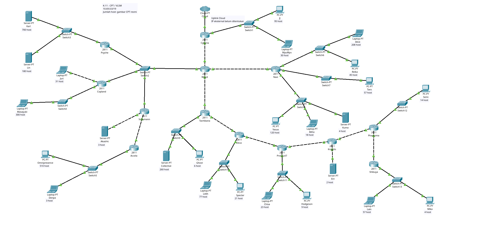

Proyek: [K11-VLSM.pkt](cpt/K11-VLSM.pkt).
Topologi terdiri dari 13 router, 13 switch, 25 perangkat akhir, dan 1 Cloud, dengan 51 kabel.
Setiap perangkat akhir mewakili satu kelompok host; rentang seluruh host tetap dicadangkan.
[Tangkapan jendela aplikasi CPT](docs/images/topology-application.png).

Switch2 menghubungkan Wired, Psyche, Copland, dan Schumann dalam satu subnet A14.
Hanya Cyberia terhubung ke Cloud. Uplink belum memiliki IP/gateway ISP; akses Internet belum terverifikasi.

## Perhitungan VLSM

Sebanyak 25 subnet membutuhkan 2.814 IP termasuk interface router.
Total ukuran blok setelah pembulatan adalah 4.188 alamat, sehingga dipakai `10.69.0.0/19`
(mask `255.255.224.0`, 8.192 alamat). Blok `/20` hanya memuat 4.096 alamat dan tidak cukup.

| Subnet | Kebutuhan IP                          | Prefix                           |
| ------ | ------------------------------------- | -------------------------------- |
| A5     | Alice 208 + Reika 45 + router 1 = 254 | `/24`; tepat 254 IP usable       |
| A7     | JJ 95 + MyuMyu 30 + router 1 = 126    | `/25`; tepat 126 IP usable       |
| A9     | Juri 31 + router 1 = 32               | `/26`                            |
| A12    | Lain 57 + Mika 4 + router 1 = 62      | `/26`; tepat 62 IP usable        |
| A14    | Empat interface router dalam satu LAN | `/29`; `/30` hanya dua IP usable |

Alokasi lengkap A1 sampai A25 tersedia pada
[spreadsheet](<Spreadsheet_Modul_4_Komdat_Jarkom_2026_VLSM(1).xlsx>) dan [tabel subnet](docs/alamat.md#subnet).

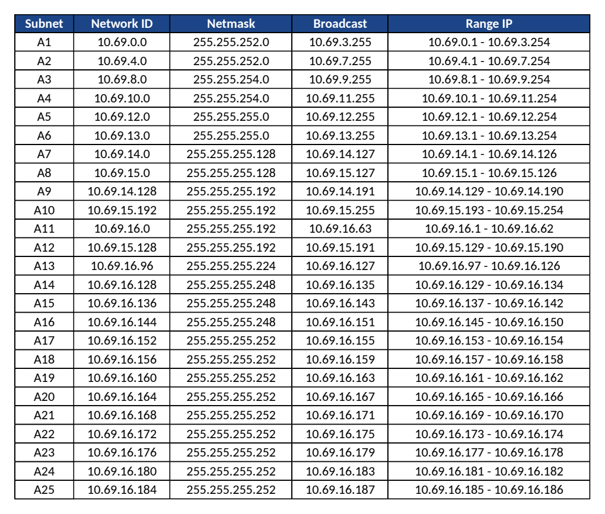

Inventaris subnet dan kebutuhan IP, sheet Rute

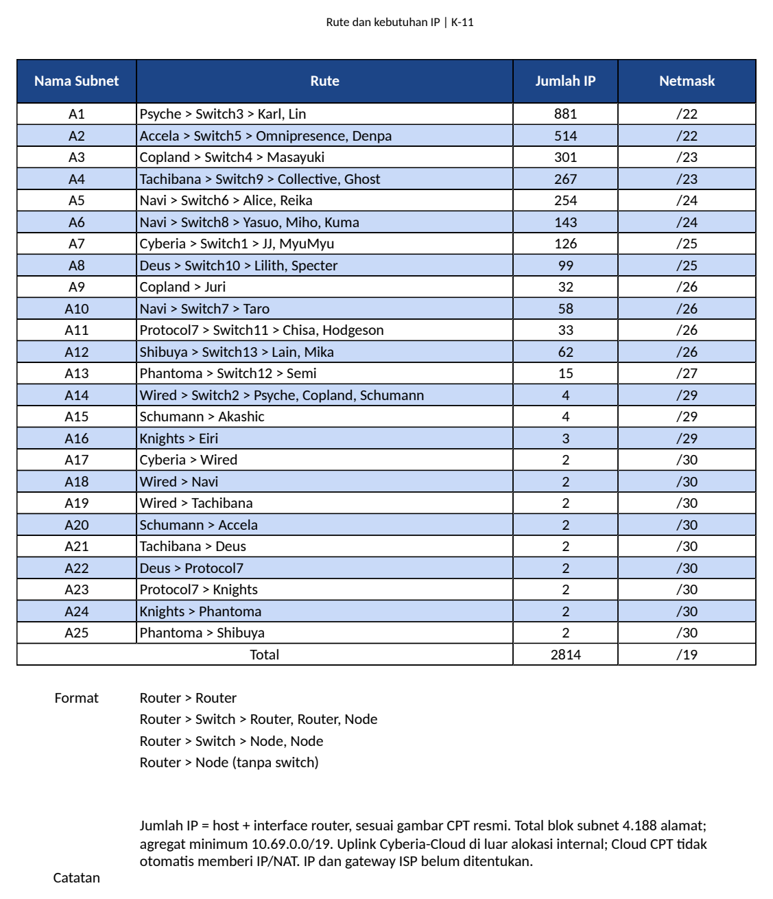

Sisa agregat yang belum dialokasikan berjumlah **4.004 alamat**, termasuk `10.69.14.192/26`
dan `10.69.16.64/27`. Blok bebas ditampilkan pada pohon berikut.

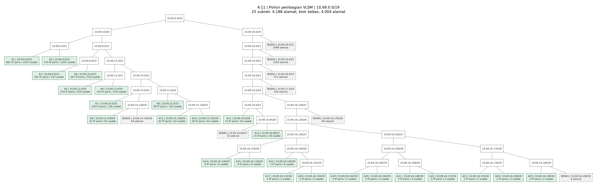

[Perbesar pohon (SVG)](docs/images/vlsm-tree.svg).

## Konfigurasi IP dan Routing

Konfigurasi mencakup 37 interface router dan 25 perangkat akhir.
Contoh Lain: IP `10.69.15.130`, mask `255.255.255.192`, gateway `10.69.15.129` (Shibuya).
[Tabel IP, interface, dan gateway lengkap](docs/alamat.md).

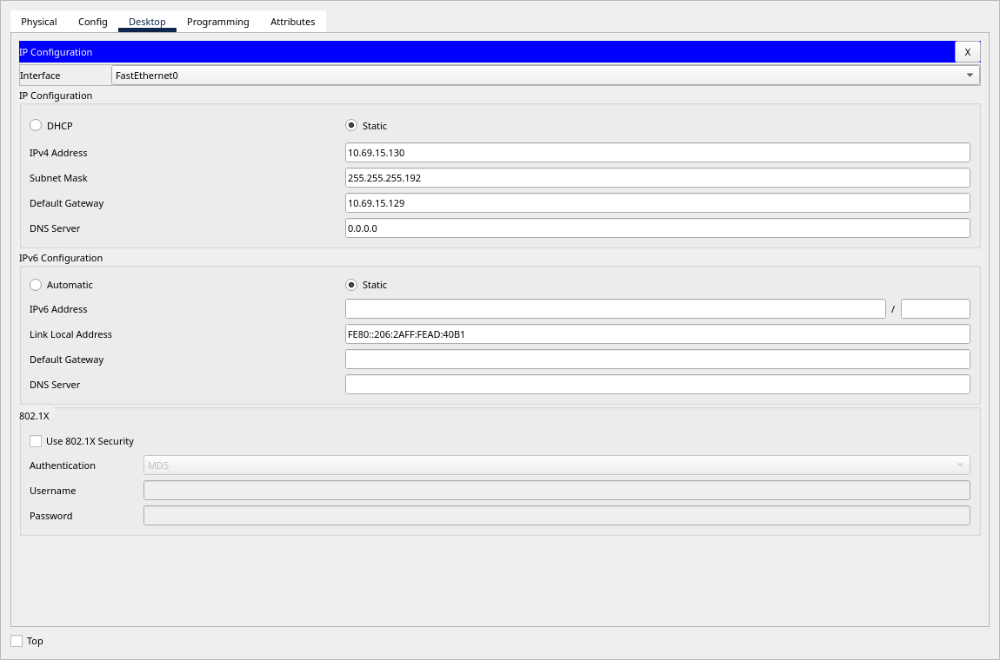

Total 54 rute statis, dengan Wired sebagai pusat. Router cabang memakai default route ke induk
serta rute spesifik untuk cabang lanjutannya. Contoh perintah dalam mode `configure terminal`:

| Router | Tujuan | Perintah |
| --- | --- | --- |
| Cyberia | Jaringan internal melalui Wired | `ip route 10.69.0.0 255.255.224.0 10.69.16.154` |
| Shibuya | Default ke Phantoma | `ip route 0.0.0.0 0.0.0.0 10.69.16.185` |
| Wired | Gabungan A5 dan A6 melalui Navi | `ip route 10.69.12.0 255.255.254.0 10.69.16.158` |

[Detail routing dan konfigurasi](docs/routing.md) serta [backup router](configs/routers/).

Interface dan tabel routing pada CPT

Shibuya menghubungkan Phantoma lewat `FastEthernet0/0` dan LAN Lain/Mika lewat `FastEthernet0/1`.
Kedua interface aktif; default route menuju `10.69.16.185`.

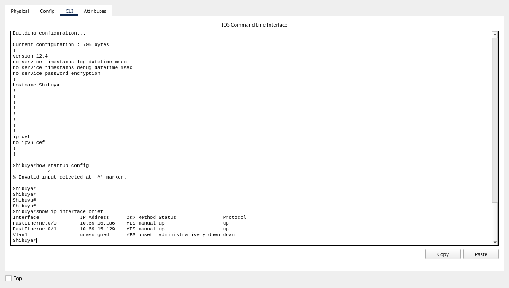

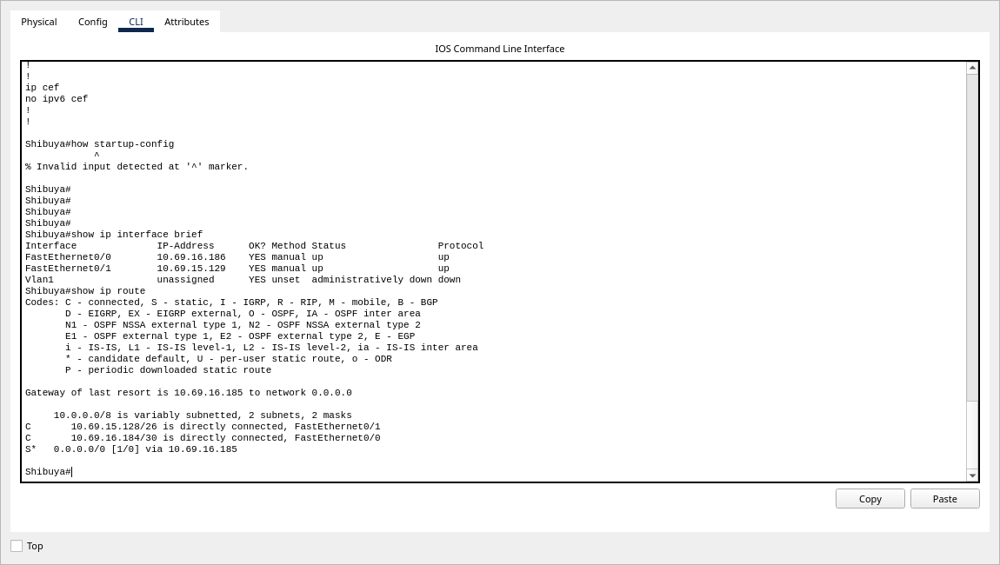

Cyberia menggunakan rute `10.69.0.0/19` ke Wired. Pada Wired, A7 `/25` menuju Cyberia,
sedangkan A9 `/26` menuju Copland.

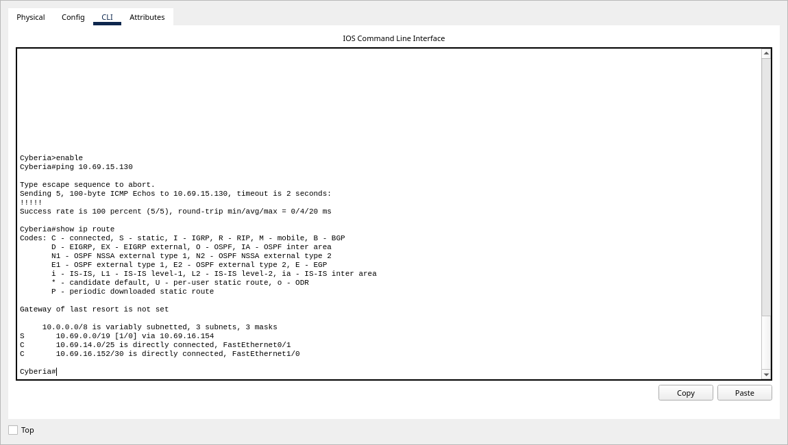

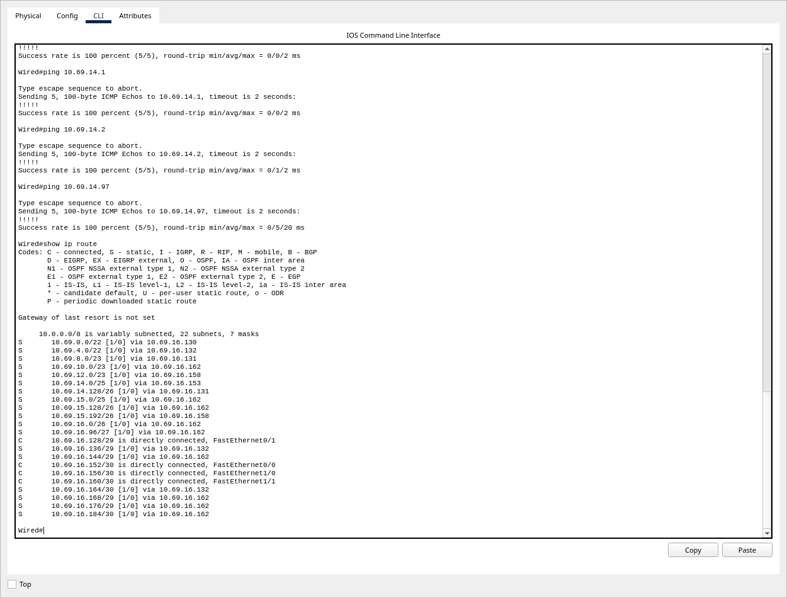

Running-config dan startup-config Shibuya dari berkas yang dibuka ulang

Konfigurasi interface dan default route tersimpan pada startup-config.
Perbandingan teks lengkap tersedia dalam [bukti CLI Shibuya](evidence/routers/Shibuya.txt).

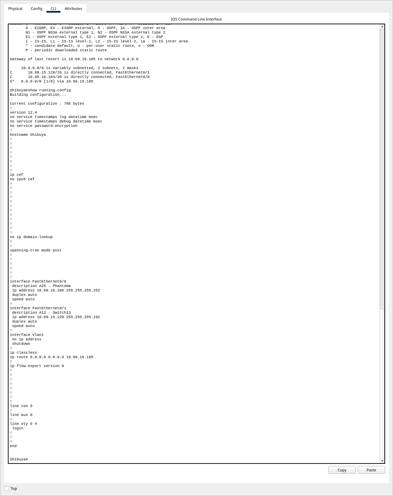

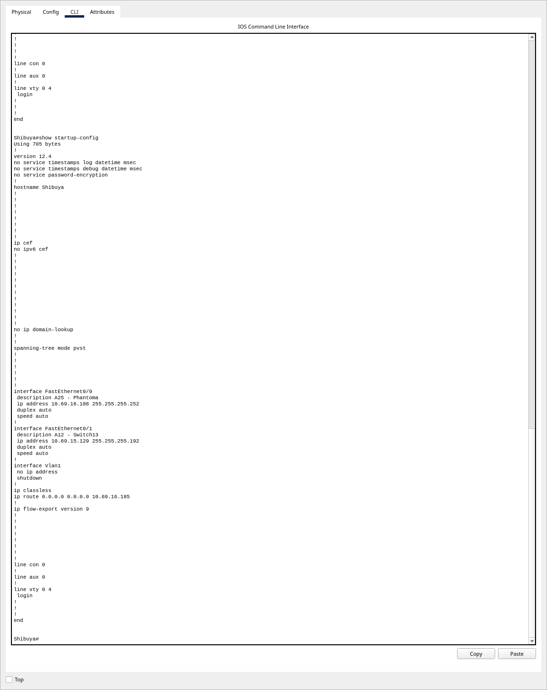

## Pengujian

Run final dilakukan melalui CPT 9.0.1.0858 pada 5 November 2026, setelah `.pkt` disimpan dan dibuka ulang.
Pengujian memakai alokasi terkoreksi A7 `10.69.14.0/25` dan A9 `10.69.14.128/26`,
pada **22.11.23 sampai 22.17.22 WIB**. Hash berkas teruji tercatat dalam [metadata bukti](evidence/README.md).

| Pengujian | Hasil |
| --- | --- |
| Perangkat akhir ke gateway | 25/25 lulus |
| Seluruh pasangan berarah, 38 node (`38 x 37`) | 1.406/1.406 lulus |
| Retry pada run final | 0 |
| Running-config dan startup-config | Sama pada 13 router |

Cyberia ke Lain: `ping 10.69.15.130`, 5/5 balasan (100%).

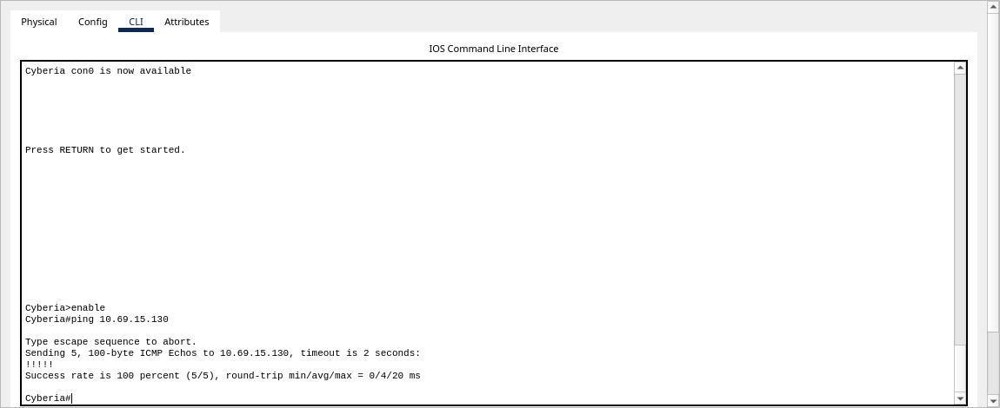

Lain ke Cyberia: `ping 10.69.14.1`, 4/4 balasan (0% loss).

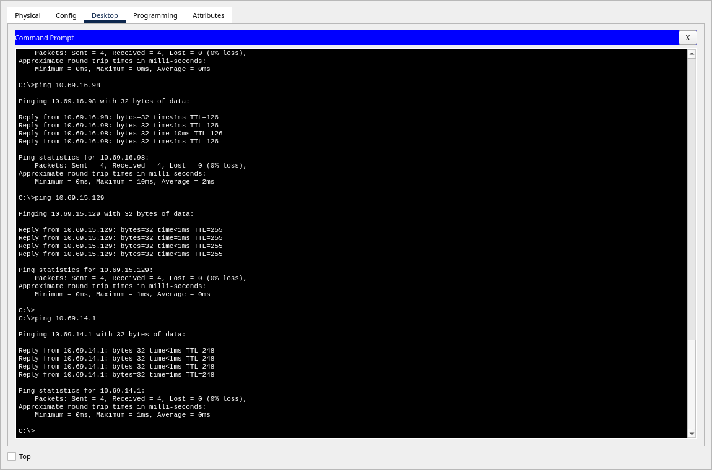

[Log ping](evidence/ping-results.json), [validasi artefak](evidence/artifact-validation.json),
dan [metode, cakupan, serta hash berkas teruji](evidence/README.md).

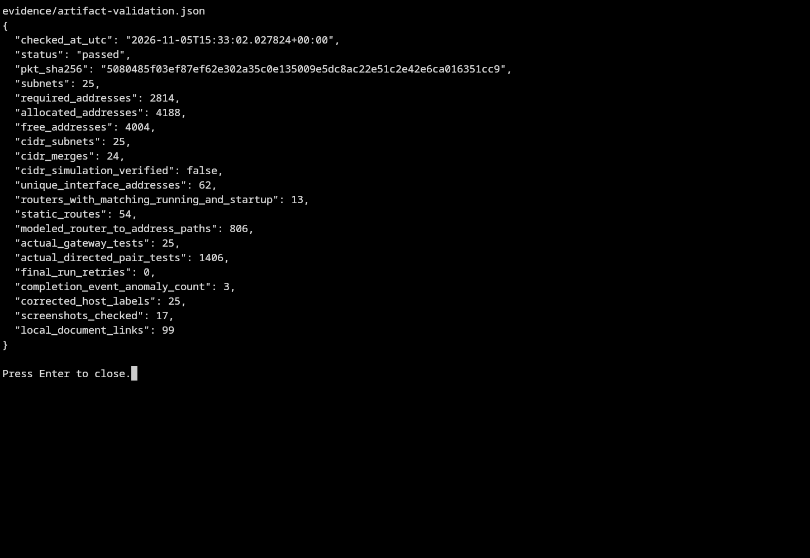
