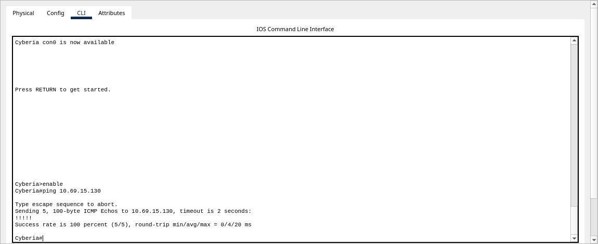
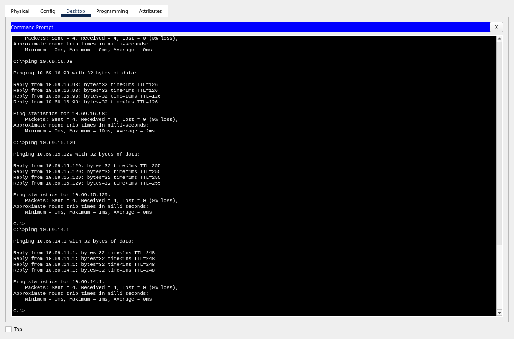

# Bukti pengujian CPT/VLSM

[Kembali ke laporan](../README.md)

Alokasi teruji sudah dikoreksi: A7 `10.69.14.0/25`, A9 `10.69.14.128/26`,
MyuMyu `10.69.14.97`, dan Reika `10.69.12.210`.

**Run final lulus: 25/25 ping gateway dan 1.406/1.406 pasangan berarah, tanpa retry pada run tersebut.**
Seluruh hasil ping berasal dari CLI Cisco Packet Tracer.

## Berkas dan lingkungan teruji

- Proyek: [K11-VLSM.pkt](../cpt/K11-VLSM.pkt), **198.659 byte**.
- Aplikasi: **Cisco Packet Tracer 9.0.1.0858**, Linux. Lihat [metadata runtime](runtime.json).
- Run final: **5 November 2026, 22.11.23 sampai 22.17.22 WIB**
  (`15:11:23.894314` sampai `15:17:22.799090` UTC).
- Berkas telah disimpan dan dibuka kembali sebelum pengujian.
  [Snapshot awal](packet-tracer-snapshot.json) dan [snapshot setelah pengujian](packet-tracer-after-tests.json)
  memiliki perangkat, kabel, IP, gateway, serta konfigurasi router yang sama.
- [Catatan pembukaan terakhir](final-reopen.json) mencatat waktu pembukaan ulang,
  hash berkas, dan penutupan jendela script setelah pengambilan screenshot.

SHA-256 berkas yang diuji:

```text
5080485f03ef87ef62e302a35c0e135009e5dc8ac22e51c2e42e6ca016351cc9
```

Cocokkan berkas untuk demo atau pengumpulan dengan perintah:

```sh
sha256sum cpt/K11-VLSM.pkt
```

Izin script untuk mengambil data hanya diaktifkan sementara dalam sesi pengujian.
Berkas final disimpan tanpa kode atau izin script tersebut; pengambilan bukti tidak menyimpan ulang `.pkt`.

## Cakupan dan hasil

| Pemeriksaan | Hasil | Bukti |
| --- | --- | --- |
| Gateway perangkat akhir | 25/25 lulus | `gateway_tests` pada [log final](ping-results.json) |
| Semua pasangan node ber-IP | 1.406/1.406 lulus | `pair_tests` pada [log final](ping-results.json) |
| Retry pada run final | 0 dari 1.431 pengujian | Setiap record memiliki satu `attempts` |
| Running-config dan startup-config | Sama pada 13 router | [Snapshot](packet-tracer-snapshot.json), [output CLI](routers/) |
| Alamat interface aktif | 62 alamat unik sesuai tabel | [Tabel alamat](../docs/addresses.csv), [snapshot](packet-tracer-snapshot.json) |
| Perhitungan subnet | 25 subnet cukup, minimal, tidak overlap | [Audit VLSM](vlsm-audit.json), [bacaan workbook](workbook-read.json) |
| Perhitungan CIDR | 25 subnet dan 24 penggabungan valid | [Audit CIDR](cidr-audit.json) |

[Validasi konsistensi artefak](artifact-validation.json) mencocokkan perhitungan, konfigurasi, tabel laporan,
pohon VLSM, cakupan dan isi transkrip ping, serta tujuan tautan lokal.

Cakupan pasangan terdiri dari **13 router dan 25 perangkat akhir**, sehingga `38 × 37 = 1.406` pasangan berarah.
Setiap ikon perangkat akhir mewakili kelompok host pada soal. Alamat tujuan setiap node tercatat dalam
objek `nodes` pada log; router menggunakan satu IP perwakilan sebagai tujuan ping dan memilih interface sumber
sesuai rute keluar. Seluruh 62 alamat interface diperiksa juga melalui inventaris serta model rute.

Switch layer 2 dan Cloud tidak memiliki IP pengujian. Daftar `devices` mentah juga memuat perangkat daya
otomatis CPT; inventaris 52 perangkat logis merujuk daftar `nodes` pada snapshot.

## Metode pencatatan

1. Buka kembali `.pkt`, cocokkan alamat dan gateway, lalu ambil `show ip interface brief`, `show ip route`,
   `show running-config`, dan `show startup-config` dari seluruh router.
2. Jalankan Fast Forward Time dan uji gateway setiap perangkat akhir.
3. Jalankan 37 putaran pasangan. Dalam setiap putaran, masing-masing dari 38 sumber mendapat tujuan berbeda;
   setiap pasangan sumber-tujuan muncul tepat sekali.
4. Kirim perintah `ping` ke CLI perangkat CPT melalui Extensions API. Simpan output aktual dari event
   `outputWritten`, perintah, tujuan, waktu mulai, dan event `commandEnded` yang diterima.
5. Nyatakan selesai setelah output memuat perintah dan statistik untuk **IP tujuan yang sama**, diikuti prompt.
   Kelulusan memerlukan `Success rate is 100 percent (5/5)` pada router, atau empat balasan dan
   `Packets: Sent = 4, Received = 4, Lost = 0 (0% loss)` pada perangkat akhir.
6. Pencatat menyediakan satu retry bila statistik ping belum seluruhnya berhasil. Run final memakai
   **nol retry**. Periksa kelengkapan pasangan dan hash `.pkt`, kemudian bandingkan snapshot setelah pengujian.

Python dipakai untuk aritmetika, pemeriksaan rute, pengendalian CLI CPT, dan penyimpanan output.
Simulasi serta balasan ICMP tetap dijalankan oleh Packet Tracer. Model rute menelusuri **806 jalur**
(`13 router × 62 alamat`) sebagai pemeriksaan tambahan.

### Event penyelesaian CLI

Pada run final, tiga event `commandEnded` hilang atau menunjuk perintah berbeda:

| Sumber | Tujuan sebenarnya | `inputCommand` yang diterima |
| --- | --- | --- |
| JJ | Navi, 10.69.12.1 | Tidak ada event |
| Cyberia | Reika, 10.69.12.210 | `ping 10.69.16.1` |
| Phantoma | Protocol7, 10.69.16.1 | Tidak ada event |

Output ping pada ketiga sumber tetap lengkap, target cocok, dan seluruh paket dibalas.
Karena itu, pencatat menggunakan statistik dan prompt pada output perangkat sebagai dasar penyelesaian.
Nilai `completed` di JSON dipertahankan apa adanya. `status: 0` pada event saja tidak membuktikan ping berhasil.

## Screenshot Cyberia dan Lain

Ping dua arah diulang untuk screenshot pada **5 November 2026, 22.28.22 sampai 22.28.28 WIB**,
dengan hash `.pkt` yang sama. [Transkrip pengambilan screenshot](distant-screenshot-pings.json)
menyimpan output kedua perintah. Gambar diambil langsung dari dialog perangkat di aplikasi CPT.

### Cyberia ke Lain

Perintah `ping 10.69.15.130`: **5/5 balasan, 100% berhasil**.



### Lain ke Cyberia

Lain memakai `10.69.15.130/26` dengan gateway `10.69.15.129`.
Perintah `ping 10.69.14.1`: **4/4 balasan, 0% loss**.



[Tangkapan aplikasi lengkap](../docs/images/topology-application.png) dan
[ekspor workspace CPT](../docs/images/topology-cpt.png) menunjukkan topologi yang digunakan.
[Manifest gambar](screenshots.json) mencatat sumber, ukuran, waktu, dan hash setiap gambar.
Screenshot konfigurasi dan worksheet disertakan pada [laporan utama](../README.md).

## Batas hasil dan koordinasi

Hasil ini membuktikan konektivitas jaringan internal CPT dengan jumlah host dari **gambar CPT resmi**.
Uplink Cyberia ke Cloud belum memiliki alamat dan gateway ISP; **akses Internet belum terverifikasi**.
Perbedaan enam jumlah host pada teks Mermaid dan gambar resmi tercatat pada [laporan](../README.md).

Kedua sheet CIDR sudah dikoreksi; [audit CIDR](cidr-audit.json) memeriksa 25 subnet dan 24 penggabungan.
Proyek serta pengujian GNS3/CIDR, tujuan pengumpulan, dan pengiriman artefak masih perlu diselesaikan kelompok.
